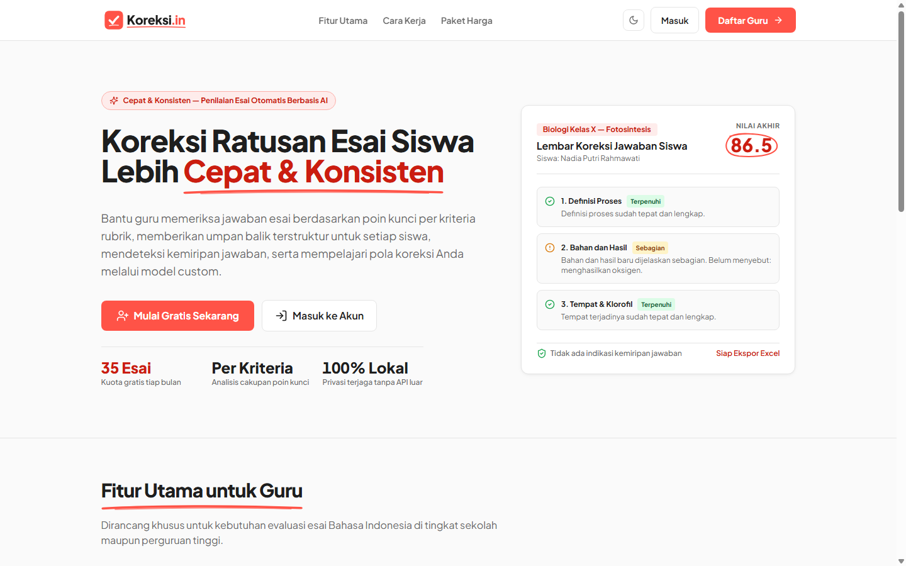
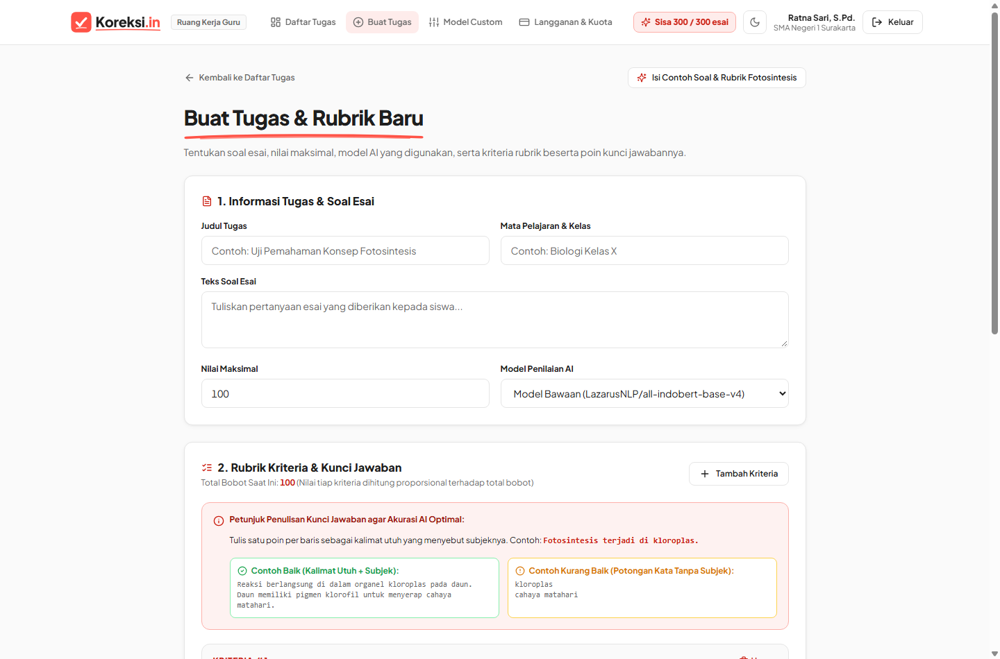
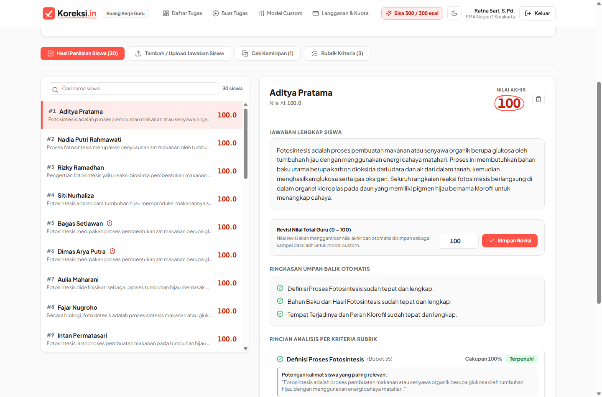
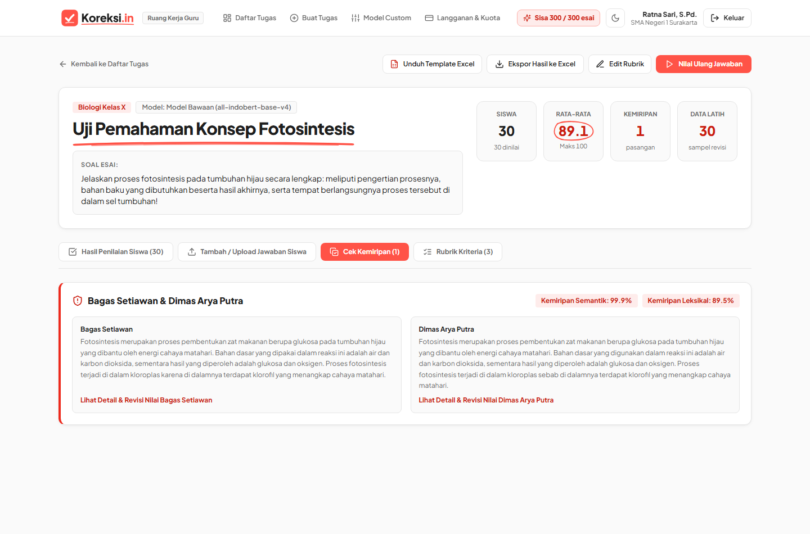
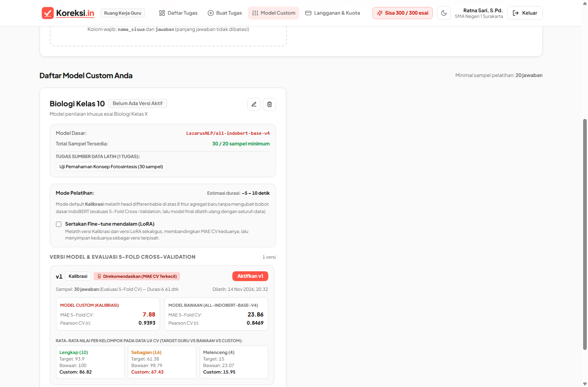
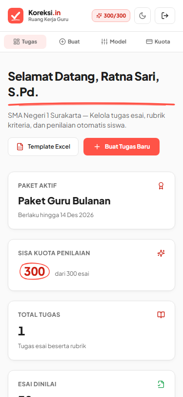

  <picture>
    <source media="(prefers-color-scheme: dark)" srcset="frontend/public/brand/koreksiin-logo-gelap.svg" />
    <source media="(prefers-color-scheme: light)" srcset="frontend/public/brand/koreksiin-logo.svg" />
    
  </picture>

<h3 align="center">Cepat &amp; Konsisten</h3>

  Platform penilaian esai otomatis untuk membantu guru Indonesia mengoreksi ratusan jawaban siswa dalam hitungan detik sesuai rubrik penilaian Anda sendiri.

---

## Mengapa Koreksi.in Hadir?

Mengoreksi jawaban esai adalah bagian penting dalam pembelajaran, namun sering kali menjadi beban terberat bagi guru:

- **Menghabiskan banyak waktu**: Membaca dan menilai puluhan hingga ratusan lembar jawaban esai satu per satu memakan waktu berjam-jam di luar jam mengajar.
- **Penilaian mudah tidak konsisten**: Ketika memeriksa lembar ke-30 atau ke-80 dalam kondisi lelah, standar penilaian bisa bergeser tanpa disadari.
- **Umpan balik ke siswa terlambat**: Karena koreksi memakan waktu lama, siswa sering menerima nilai tanpa catatan yang jelas tentang bagian mana yang masih kurang tepat.

Koreksi.in membantu Anda menjaga kualitas penilaian tetap konsisten dari siswa pertama hingga siswa terakhir, sekaligus menghemat waktu berharga Anda untuk mendampingi siswa belajar.

---

## Fitur Utama

- **Penilaian Berbasis Rubrik dan Makna**
  Sistem memahami makna kalimat jawaban siswa berdasarkan poin-poin kunci di rubrik Anda, bukan sekadar mencocokkan kata kunci yang persis sama.
- **Feedback Otomatis yang Spesifik**
  Setiap siswa otomatis menerima catatan per kriteria yang menyebutkan dengan jelas poin mana yang sudah tercakup dan poin mana yang belum dijelaskan.
- **Deteksi Jawaban Terlalu Mirip Antarsiswa**
  Menandai pasangan jawaban siswa yang terindikasi menyalin satu sama lain sehingga Anda dapat memeriksanya dengan cepat dan adil.
- **Model Custom yang Belajar dari Gaya Menilai Guru**
  Sistem dapat mempelajari pola koreksi dan ketegasan penilaian Anda sendiri agar hasil koreksi otomatis semakin selaras dengan standar Anda.
- **Upload Jawaban via Excel**
  Unggah jawaban satu kelas sekaligus menggunakan template Excel yang sudah disediakan tanpa perlu menyalin satu per satu.
- **Ekspor Hasil Lengkap ke Excel**
  Unduh rekap nilai akhir, rincian skor tiap kriteria, serta umpan balik seluruh siswa dalam satu file Excel yang siap dibagikan atau diolah menjadi rapor.
- **Revisi Nilai Penuh oleh Guru**
  Anda selalu memegang kendali akhir: ubah nilai siswa kapan saja secara langsung, dan setiap revisi dapat dijadikan bahan belajar bagi model custom Anda.

---

## Cara Kerja dalam 3 Langkah

1. **Buat Tugas & Rubrik Penilaian**
   Tulis soal esai, tentukan kriteria penilaian beserta bobotnya, lalu masukkan poin-poin kunci jawaban yang diharapkan.
2. **Upload Jawaban Siswa**
   Unggah daftar jawaban siswa sekaligus melalui file Excel atau masukkan langsung satu per satu.
3. **Terima Nilai, Feedback, & Rekap**
   Jalankan penilaian otomatis, tinjau skor beserta catatan tiap kriteria, cek peringatan kemiripan jawaban, revisi bila perlu, lalu unduh hasilnya.

---

## Tampilan Aplikasi

### Halaman Beranda & Ruang Kerja Guru

| Halaman Beranda | Form Pembuatan Tugas & Rubrik |
| :---: | :---: |
|  |  |

### Hasil Penilaian, Feedback, & Deteksi Kemiripan

| Hasil Penilaian & Feedback Otomatis | Panel Deteksi Kemiripan Jawaban |
| :---: | :---: |
|  |  |

### Model Custom Guru & Tampilan Ponsel

| Pelatihan Model Custom Guru | Tampilan Responsif di Ponsel |
| :---: | :---: |
|  |  |

---

## Paket Harga

Mulai gratis setiap bulan tanpa kartu kredit, lalu tingkatkan paket sesuai kebutuhan kelas atau sekolah Anda. Pembayaran prabayar mendukung **QRIS**, **e-wallet** (GoPay, ShopeePay, Dana), **Virtual Account bank** (BCA, Mandiri, BNI, BRI, Permata, dan lainnya), serta **gerai retail** (Indomaret, Alfamart).

| Paket | Harga | Kuota Jawaban Siswa | Masa Aktif | Keterangan |
| :--- | :--- | :--- | :--- | :--- |
| **Paket Gratis** | Rp 0 | 35 esai / bulan | 30 hari (reset otomatis) | Cocok untuk mencoba penilaian otomatis dan fitur dasar |
| **Paket Guru Bulanan** | Rp 49.000 | 300 esai | 30 hari | Pilihan tepat untuk ulangan harian dan ujian tengah semester |
| **Paket Sekolah Tahunan** | Rp 450.000 | 4.000 esai | 365 hari | Kuota besar untuk dua semester penuh dengan harga lebih hemat |
| **Add-on Kuota +150 Esai** | Rp 20.000 | +150 esai | Mengikuti masa aktif paket | Tambahan kuota instan saat kebutuhan penilaian meningkat |

---

## Hasil Uji pada Data Contoh

Pada pengujian internal (**hasil uji pada data contoh 30 jawaban** esai siswa mata pelajaran Biologi menggunakan validasi silang 5 lipatan), penyesuaian model custom terhadap pola koreksi guru terbukti mendekatkan hasil penilaian otomatis ke standar nilai guru:

| Metrik Evaluasi (Data Contoh 30 Jawaban) | Model Bawaan | Model Custom Guru |
| :--- | :--- | :--- |
| **Rata-rata Selisih Nilai (MAE)** *(lebih kecil lebih baik)* | 15,68 poin | **6,40 poin** |
| **Korelasi Keselarasan Nilai (Pearson)** *(mendekati 1,00 lebih baik)* | 0,87 | **0,96** |

*Catatan: Angka di atas merupakan hasil uji pada data contoh 30 jawaban dan bukan klaim akurasi umum untuk seluruh jenis soal maupun mata pelajaran.*

---

## Pertanyaan yang Sering Diajukan (FAQ)

**Apakah nilai dari sistem ini menggantikan peran guru?**
Tidak. Koreksi.in berperan sebagai asisten koreksi pertama Anda. Guru selalu dapat meninjau rincian penilaian, memeriksa jawaban asli siswa, dan merevisi nilai akhir kapan saja sebelum dibagikan.

**Apakah data soal dan jawaban siswa aman?**
Ya. Seluruh proses analisis jawaban berjalan di lingkungan server aplikasi sendiri tanpa mengirim naskah soal maupun jawaban siswa ke layanan pihak ketiga di luar sistem.

**Berapa lama proses penilaian untuk satu kelas?**
Untuk satu kelas berisi sekitar 30 jawaban esai, penilaian biasanya selesai dalam hitungan beberapa detik hingga kurang dari satu menit.

**Apakah bisa digunakan untuk mata pelajaran lain selain Biologi?**
Ya. Selama soal berbentuk uraian atau esai berbahasa Indonesia dan memiliki rubrik poin kunci yang jelas, Koreksi.in dapat digunakan untuk berbagai mata pelajaran seperti IPA, IPS, Bahasa Indonesia, PPKn, Ekonomi, hingga mata kuliah umum.

**Bagaimana cara kuota esai dihitung?**
Kuota hanya terpotong satu kali untuk setiap jawaban siswa baru yang dinilai. Jika Anda menilai ulang jawaban siswa yang sama (misalnya setelah mengaktifkan model custom baru atau memperbaiki rubrik), kuota Anda tidak akan terpotong lagi.

---

## Tim Pengembang (Kelompok 3 — Informatika UNS)

Koreksi.in dikembangkan sebagai proyek mata kuliah Kewirausahaan oleh Mahasiswa Program Studi Informatika, Universitas Sebelas Maret:

| Nama | Peran |
| :--- | :--- |
| **Ahmad Syauqi** | Frontend Developer |
| **Aristo Budiman** | Project Manager & AI Engineer |
| **Avecena Hidayat** | Backend Developer |
| **Usrotun Saidah** | UI/UX Designer |

---

## Siap Menghemat Waktu Koreksi Anda?

Coba **Koreksi.in** sekarang dengan kuota gratis 35 esai setiap bulan — nilai ratusan jawaban siswa secara **Cepat & Konsisten** tanpa mengorbankan ketelitian umpan balik.

---
Untuk developer: lihat [PROJEK.md](PROJEK.md)
